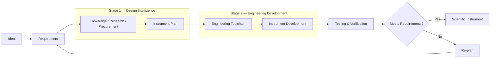
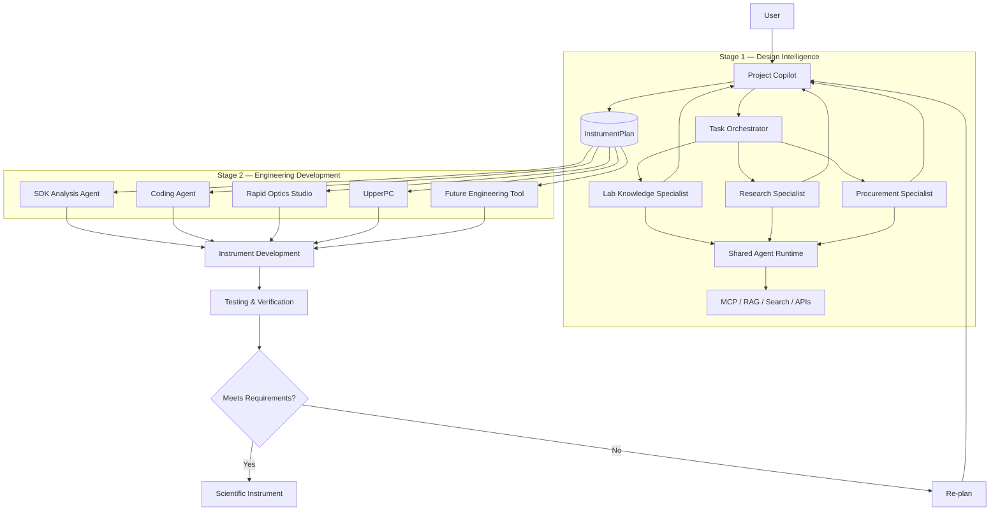
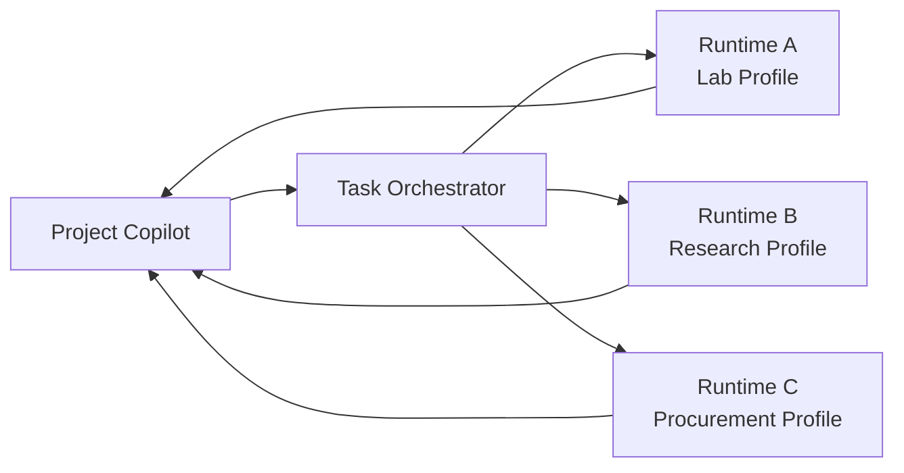
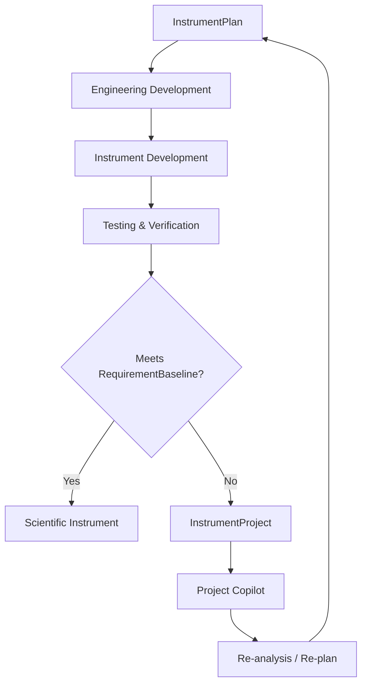

# MetaInstrumentStudio

> **AI-native Scientific Instrument Engineering Platform**  
> 面向科研仪器研发全过程的 AI 原生工程平台。

MetaInstrumentStudio 旨在把科研仪器研发过程中原本分散的工作——**需求定义、课题组知识复用、外部研究调研、器件采购分析、方案设计、软件开发、光学设计、仪器实现、测试验证与迭代规划**——组织到一个统一、可追溯、可扩展的工程工作空间中。

---

## 1. Core Idea

MetaInstrumentStudio 的整体研发流程明确分为两个阶段：



- **Stage 1 — Design Intelligence**：回答“这台仪器应该怎么设计？”
- **Stage 2 — Engineering Development**：回答“这个方案具体怎么实现？”

---

## 2. Overall Architecture



---

## 3. Stage 1 — Design Intelligence

Stage 1 将：

```text
User Requirements
+
Lab Knowledge
+
External Research
+
Procurement Feasibility
```

综合成：

```text
Instrument Plan
```

Stage 1 采用：

> **Supervisor–Specialist Logical Multi-Agent Architecture with Shared Runtime**

---

## 4. Core Agents

### Project Copilot

负责 Requirement Discovery、任务拆解、AgentTaskBrief、Cross-domain Synthesis、InstrumentPlan 和 Re-plan。

### Lab Knowledge Specialist

负责内部知识与工程记忆。

### Research Specialist

负责外部论文、技术路线、Benchmark 和 Evidence。

### Procurement Specialist

负责器件、厂商、参数、价格、库存、交期与替代方案。

---

## 5. Task Orchestrator & Shared Runtime

Task Orchestrator 负责 Scheduling、Agent Selection、Parallel Execution、Retry、Timeout、Result Collection 和 Tracing。

多个 Specialist 在逻辑上独立，但 V1 可以共享统一 Agent Runtime。



---

## 6. Agent vs MCP / Tool

> **Tool 是能力，Agent 是使用一组能力完成专业目标的责任主体。**

```text
Agent
→ Goal / Planning / Tool Selection / Execution / Artifact

MCP / Tool
→ Search / Retrieval / API / Database / Action
```

---

## 7. Interaction Model

“交互方式”和“双阶段研发流程”是两个不同维度。

系统提供：

```text
Conversation Workspace
Instrument Project Workspace
```

### Conversation Workspace

面向轻量查询、调研、采购比较。

用户可设置：

```text
Auto
Lab Knowledge
Research
Procurement
```

指定 Agent 是一种 **Routing Preference**。

### Instrument Project Workspace

用于完整科研仪器研发：

```text
User
 ↓
Project Copilot
 ↓
RequirementBaseline
 ↓
Task Decomposition
 ↓
AgentTaskBrief
 ↓
Task Orchestrator
 ↓
Specialist Agents
 ↓
AgentArtifacts
 ↓
Project Copilot
 ↓
InstrumentPlan
 ↓
Stage 2 — Engineering Development
```

---

## 8. Core Data Objects

```text
InstrumentProject
RequirementBaseline
AgentTaskBrief
AgentArtifact
InstrumentPlan
Evidence / Provenance
```

`InstrumentProject` 是 Stage 1 与 Stage 2 的主要数据桥梁。

---

## 9. Stage 2 — Engineering Development

Stage 2 将 `InstrumentPlan` 转换成真实工程实现。

| Component | Purpose |
|---|---|
| SDK Analysis Agent | SDK 文档分析、检索与开发上下文生成 |
| Coding Agent | 基于 Project / SDK Context 辅助软件开发 |
| Rapid Optics Studio | 光学设计、仿真、虚拟采集与光谱分析 |
| UpperPC | 面向真实科研仪器的上位机控制软件 |
| Future Engineering Tool | 未来机械、电路、数据分析等工程能力 |

---

## 10. Testing and Re-plan Loop



---

## 11. V1 Recommended Deployment

```text
One Agent Service
│
├── Conversation Controller
├── Project Copilot
├── Task Orchestrator
├── Shared Agent Runtime
│   ├── LabKnowledgeProfile
│   ├── ResearchProfile
│   └── ProcurementProfile
│
├── MCP / Tool Gateway
│   ├── Internal Knowledge
│   ├── Research / Search
│   └── Procurement / Vendor
│
└── Project Service
    ├── InstrumentProject
    ├── RequirementBaseline
    ├── AgentTaskBrief
    ├── AgentArtifact
    └── InstrumentPlan
```

---

## 12. Summary

MetaInstrumentStudio 可以概括为：

> **一个统一平台、两个研发阶段、两种工作形态、一个 Project Copilot、多类 Specialist Agents、一套 Shared Agent Runtime、一个 Task Orchestrator，以及一组专业 Engineering Tools。**

```text
Stage 1 — Design Intelligence
Project Copilot
→ Specialist Agents
→ Evidence / Artifacts
→ InstrumentPlan

Stage 2 — Engineering Development
SDK Analysis
→ Coding
→ Optical Engineering
→ Instrument Control
→ Instrument Development

Testing & Verification
→ Re-plan
→ Stage 1
```
