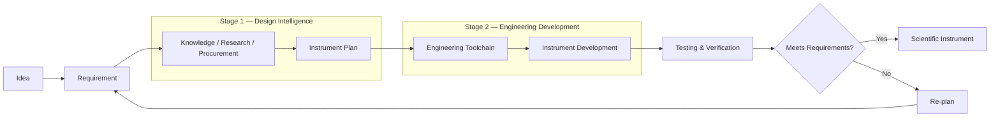
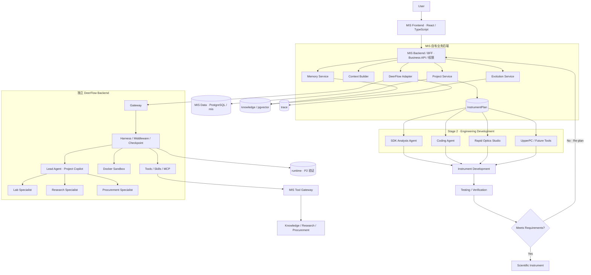
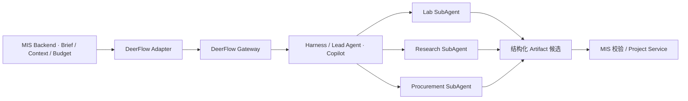
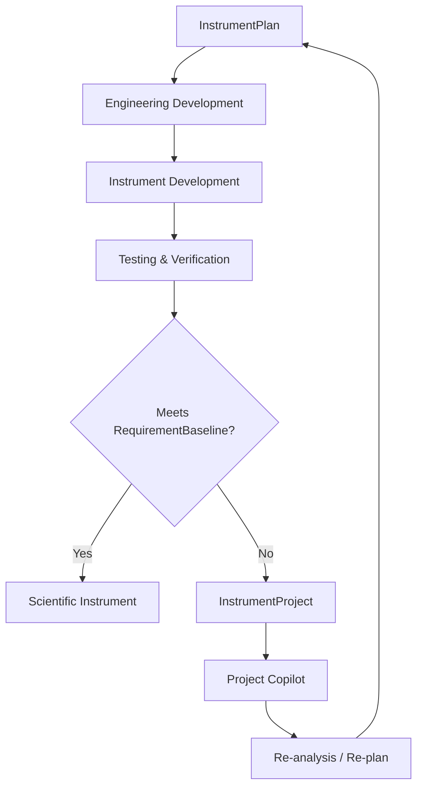

# MetaInstrumentStudio

> **AI-native Scientific Instrument Engineering Platform**  
> 面向科研仪器研发全过程的 AI 原生工程平台。

MetaInstrumentStudio 旨在把科研仪器研发过程中原本分散的工作——**需求定义、课题组知识复用、外部研究调研、器件采购分析、方案设计、软件开发、光学设计、仪器实现、测试验证与迭代规划**——组织到一个统一、可追溯、可扩展的工程工作空间中。

---

修订记录：

- 2026-11-08，依据 [ADR-0002](adr/0002-agent-runtime-and-integration.md) 确认 DeerFlow Backend + MIS 自研 React UI + MIS 自有业务后端，更新总体架构、执行边界和 V1 部署；具体兼容性待 P2 验证。
- 2026-11-08，在第 5 节增加已确认的 C1 Trace 可观测性与 C2 经验评分、生命周期高层架构；不改变既有章节编号。

## 1. Core Idea

MetaInstrumentStudio 的整体研发流程明确分为两个阶段：



- **Stage 1 — Design Intelligence**：回答“这台仪器应该怎么设计？”
- **Stage 2 — Engineering Development**：回答“这个方案具体怎么实现？”

---

## 2. Overall Architecture



MIS Frontend 只调用 MIS Backend / BFF，不直连 DeerFlow。DeerFlow 提供 Agent 执行能力，MIS 自主管理业务 API、Context、Memory、Evolution、权限及数据。Runtime 的结果必须经 MIS 校验和 Project Service 写入，图中关系不授予运行层直接修改业务库的权限。


---

## 3. Stage 1 — Design Intelligence

Stage 1 将：

```text
User Requirements
+
Lab Knowledge
+
External Research
+
Procurement Feasibility
```

综合成：

```text
Instrument Plan
```

Stage 1 采用：

> **Supervisor–Specialist Logical Multi-Agent Architecture with Shared Runtime**

---

## 4. Core Agents

### Project Copilot

负责 Requirement Discovery、任务拆解、AgentTaskBrief、Cross-domain Synthesis、InstrumentPlan 和 Re-plan。

### Lab Knowledge Specialist

负责内部知识与工程记忆。

### Research Specialist

负责外部论文、技术路线、Benchmark 和 Evidence。

### Procurement Specialist

负责器件、厂商、参数、价格、库存、交期与替代方案。

---

## 5. Task Orchestrator & Shared Runtime

Task Orchestrator 是调度、并行、重试、超时、结果收集和 Tracing 的逻辑职责。MIS 定义 Brief、依赖、预算和验收条件，DeerFlow Lead Agent / SubAgents 提供执行机制，不另建一套通用执行引擎。

Project Copilot 的业务角色由 Lead Agent 承载；Lab、Research、Procurement Specialist 由独立配置的 SubAgent 承载。Specialist 之间不直接沟通，全部经 Copilot 汇总结构化 Artifact。MIS Context Builder 控制资料、角色和记忆选择，DeerFlow Middleware 执行上下文注入与通用处理；原生 Memory 关闭或替换，长期记忆由 MIS Memory Service 管理。



接口、权限和执行机制见 [Agent 内部架构设计](design/agent_architecture.md)；技术选择、版本锁定与重新评估条件见 [ADR-0002](adr/0002-agent-runtime-and-integration.md)。

### Memory Architecture

```text
Memory Architecture
├── Project Memory
│   └── PostgreSQL / mis
├── Cross-project Knowledge（PostgreSQL / knowledge）
│   ├── Lab Knowledge
│   └── Experience Memory
│       ├── Promotion Pool
│       ├── Scoring
│       └── Lifecycle Management
└── Working Memory
    └── Agent Runtime
```

项目记忆和跨项目知识严格分开；实验室知识与经验记忆共享知识库。经验必须经过晋升审核，P5 人工审核通过后才正式对 Agent 可见，使用前需要重新查证。只有经验记忆参与 C2 综合评分、成熟度、有效性和生命周期管理；实验室原始文档通过版本管理和人工复核维护。

### Trace & Observability

```text
Run
 └── Task
      └── Span
           ├── LLM
           ├── Tool
           ├── RAG
           ├── Memory
           ├── Rule
           └── Human Interaction
```

遵循 C1 的 OpenTelemetry Trace + GenAI Semantic Conventions，对关键业务 Span 100% 采集。PostgreSQL `trace` schema 分离存储 Skeleton 与 Payload，内容按 Hash 去重；骨架永久保留，基准运行和人工确认的错误案例内容永久保留，普通运行内容保留 90 天。

Trace 与业务记录通过 RunRef（run_id、trace_id）及业务 ID 关联，与 Agent Runtime 状态分离；Trace 记录过程，Evidence 负责事实溯源，Artifact 与 InstrumentPlan 保存业务结果。Trace 支持 Memory Scoring 的数据反馈：详细执行过程在 `trace`，供评分使用的结构化 MemoryUsageEvent 和 MemoryScoreHistory 在 `knowledge`，通过 trace_id / span_id 关联。

详细规范以 [Agent 架构需求清单 C1/C2](design/agent_architecture_requirements.md#4-已确认的补充架构决策) 为准。

---

## 6. Agent vs MCP / Tool

> **Tool 是能力，Agent 是使用一组能力完成专业目标的责任主体。**

```text
Agent
→ Goal / Planning / Tool Selection / Execution / Artifact

MCP / Tool
→ Search / Retrieval / API / Database / Action
```

---

## 7. Interaction Model

“交互方式”和“双阶段研发流程”是两个不同维度。

系统提供：

```text
Conversation Workspace
Instrument Project Workspace
```

### Conversation Workspace

面向轻量查询、调研、采购比较。

用户可设置：

```text
Auto
Lab Knowledge
Research
Procurement
```

指定 Agent 是一种 **Routing Preference**。

### Instrument Project Workspace

用于完整科研仪器研发：

```text
User
 ↓
Project Copilot
 ↓
RequirementBaseline
 ↓
Task Decomposition
 ↓
AgentTaskBrief
 ↓
Task Orchestrator
 ↓
Specialist Agents
 ↓
AgentArtifacts
 ↓
Project Copilot
 ↓
InstrumentPlan
 ↓
Stage 2 — Engineering Development
```

---

## 8. Core Data Objects

```text
InstrumentProject
RequirementBaseline
AgentTaskBrief
AgentArtifact
InstrumentPlan
Evidence / Provenance
```

`InstrumentProject` 是 Stage 1 与 Stage 2 的主要数据桥梁。

---

## 9. Stage 2 — Engineering Development

Stage 2 将 `InstrumentPlan` 转换成真实工程实现。

| Component | Purpose |
|---|---|
| SDK Analysis Agent | SDK 文档分析、检索与开发上下文生成 |
| Coding Agent | 基于 Project / SDK Context 辅助软件开发 |
| Rapid Optics Studio | 光学设计、仿真、虚拟采集与光谱分析 |
| UpperPC | 面向真实科研仪器的上位机控制软件 |
| Future Engineering Tool | 未来机械、电路、数据分析等工程能力 |

---

## 10. Testing and Re-plan Loop



---

## 11. V1 Recommended Deployment

```text
MIS Frontend（React + TypeScript；不使用 DeerFlow Next.js UI）
       │ REST / SSE
       ▼
MIS Backend / BFF
├── Business API / 权限 / Conversation Controller
├── Project Service / Rule Engine
├── Context Builder
├── Memory Service
├── Evolution Service
├── MIS Tool Gateway
└── DeerFlow Adapter
       │ 内部服务调用
       ▼
DeerFlow Backend（独立部署）
├── Gateway → Harness / Middleware
├── Lead Agent（Project Copilot）
├── SubAgents（Lab / Research / Procurement）
├── Skills / Tools / MCP
├── Docker Sandbox
└── Checkpoint（优先 PostgreSQL runtime，P2 验证）

MIS Data Layer · PostgreSQL + pgvector
├── mis        项目、需求、问答、证据、产物、方案、测试结果
├── runtime    Agent 执行状态，与业务记录隔离
├── trace      Skeleton / Payload，遵循 C1
├── knowledge  实验室知识、经验、晋升池、评分和使用历史，遵循 C2
└── cache      外部调用缓存
```

Gateway / Harness 表示 DeerFlow Backend 的逻辑边界，具体服务拓扑由锁定版本决定。DeerFlow 不直接写入 MIS 业务主数据；所有业务写入经 MIS 服务。原始文件按既有方案由 MIS 保存文件及数据库引用。

P2 验证最小独立调用与集成，不部署正式产品；P3 建立自研 React 只读页与 Trace，P5 扩展正式工作空间。Docker Sandbox 在具备 Docker 的 CI / 远程环境验证，不要求在受限制的 Windows 开发机安装 Docker。具体环境、上游 commit 和隔离能力仍需验证，不把本部署图视为已上线事实。


---

## 12. Summary

MetaInstrumentStudio 可以概括为：

> **一个统一平台、两个研发阶段、两种工作形态、一个 Project Copilot、多类 Specialist Agents、一套 Shared Agent Runtime、一个 Task Orchestrator，以及一组专业 Engineering Tools。**

```text
Stage 1 — Design Intelligence
Project Copilot
→ Specialist Agents
→ Evidence / Artifacts
→ InstrumentPlan

Stage 2 — Engineering Development
SDK Analysis
→ Coding
→ Optical Engineering
→ Instrument Control
→ Instrument Development

Testing & Verification
→ Re-plan
→ Stage 1
```
