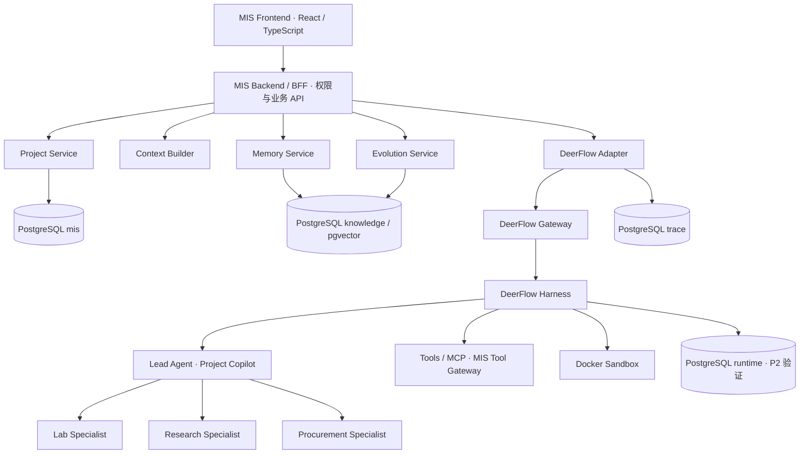

# MIS Agent 内部架构设计

- 状态：技术路线与模块边界已确认；V1 设计基线，具体上游接口和兼容性待 P2 Integration Spike 验证
- 日期：2026-11-08
- 修订：2026-11-08，基于已确认的 DeerFlow Backend + MIS 自研 UI / Backend 路线建立设计；本文件不表示实现完成
- 决策依据：[ADR-0002](../adr/0002-agent-runtime-and-integration.md)、[Agent 架构需求清单](agent_architecture_requirements.md) A1–A8、C1、C2
- 相关：[总体架构](../architecture.md)、[开发计划](../plans/development_plan.md)、[数据库与权限](../adr/0001-repo-structure-and-stack.md)

## 1. Architecture Overview

### 1.1 总体边界



DeerFlow Backend 独立部署；Gateway 与 Harness 是上游服务入口和内部执行逻辑，具体进程拓扑随锁定版本验证。MIS 不部署、不 Fork DeerFlow Next.js 前端，不直接修改核心执行引擎。

### 1.2 角色、模块与责任

| 模块 | 输入与输出 | 所有者 |
|---|---|---|
| Project Copilot | 已确认需求 → Brief → 经校验的 Artifact 摘要 → InstrumentPlan 草稿 | MIS 定义业务规则，由 DeerFlow Lead Agent 执行 |
| Specialist | 自己的 Brief、授权资料与技能 → 结构化候选、Claim、未知项和 Evidence 引用 | MIS Profile，由 DeerFlow SubAgent 执行 |
| Task Orchestrator | 依赖、预算、接收条件 → 调度、并行、重试、超时和结果状态 | MIS 定义约束，DeerFlow 提供执行机制 |
| Project Service | 业务对象、引用、版本、状态历史 → 可追溯业务记录 | MIS |
| Context Builder | 角色、Brief、资料范围、预算、记忆候选 → 角色隔离的上下文包 | MIS |
| Memory Service | 授权范围、检索 Query、使用事件 → 线索、评分与治理记录 | MIS |
| Evolution Service | 已确认错误、Trace、基准结果 → 候选改进与待审核发布 | MIS |
| DeerFlow Adapter | MIS 执行命令 ↔ 上游调用；上游事件 → MIS 事件 | MIS |

Specialist 不直接通信，也不能通过共享文件或共享历史绕过 A3。新增 Agent 或工具不能默认继承所有其他角色的权限。下文接口名是 MIS 逻辑契约，不宣称是上游现成 API；最终字段与传输绑定在 P2 登记。

## 2. Runtime Integration

### 2.1 Gateway、Harness 与 Adapter

MIS Backend 经内部认证调用 DeerFlow Gateway；Harness 承担模型循环、Lead/SubAgent 执行、Middleware、工具和 Checkpoint。Adapter 封装锁定版本的实际接口，前端和 Project Service 不导入 DeerFlow 内部对象。

| MIS 逻辑接口 | 语义与约束 |
|---|---|
| start_run | 接收 MIS thread_id、run_id、需求版本、ContextPackage 引用、预算、幂等键，建立 runtime ID 映射后启动 |
| get_run / stream_events | 查询权威运行状态，输出 MIS 事件；断流不等于运行失败 |
| resume_run | 校验 question_id、用户决定 Evidence 与 checkpoint 关联，幂等恢复暂停点 |
| cancel_run | 请求取消，跟踪实际停止与 Sandbox 清理；状态不能先于执行确认 |
| accept_result | 接收 Artifact 候选，经 schema、单位、证据和项目范围校验后调用 Project Service 写入 |

命令不得把任意用户输入当作权限或工具配置。上游模型输出不是可直接执行的数据库操作。

### 2.2 一次规划的数据流

1. 用户经 BFF 确认 RequirementBaseline；Project Service 保存版本与确认记录（A7）。
2. BFF 分配 run_id，绑定项目、会话、基线版本、执行与配置版本。
3. Copilot 在 MIS 约束下生成并保存 Brief；Context Builder 为每个角色构建独立输入，Brief 区分指定参数与不定参数。
4. Adapter 将 MIS 任务映射到 DeerFlow Lead / SubAgents；依赖允许的任务并行，工具调用经过授权边界。
5. 工具原文与来源先登记 Evidence；Specialist 输出结构化 Artifact，不能把运行文件本身当成已采纳业务产物。
6. MIS 验证 Artifact：结构、证据存在、单位与量纲、硬约束三值判断；失败有限重试或记录缺口，不无限循环。
7. Copilot 仅接收已校验 Artifact 摘要与引用，生成带证据的 Plan 草稿；采纳仍由人确认。

### 2.3 状态、恢复与幂等

MIS 对外运行状态使用 queued / running / waiting_user / completed / failed / cancelled 的设计语义；具体状态模型在 P2 契约定稿，不追加到 P1 核心对象范围。Artifact 的 draft / accepted / rejected / stale 与运行状态分离；运行结束不自动代表方案采纳。

A4 提问时先通过 Project Service 保存 UserQuestion，绑定运行与暂停点，再持久暂停。回答通过 BFF 写成 user_decision Evidence，校验回答问题与 checkpoint 一致后恢复。进程重启后从持久暂停点继续；重复提交同一回答不得重复恢复。若写入问题和暂停之间失败，靠关联 ID 对账，不依赖跨服务事务假设。

Adapter 命令和业务结果按 run_id、task_id、业务对象 ID / 幂等键去重；Checkpoint 与业务写入之间不假设 exactly-once。业务写入后、checkpoint 前崩溃，重放必须返回既有记录；恢复后不能重复收费式地执行已确认的外部动作。部分 Specialist 超时保留其他产物，Plan 列出缺口；超预算由确定性执行层截停。

PostgreSQL Checkpoint、暂停恢复及失败恢复是 P2 门槛，不因采用 DeerFlow 而假定已具备。`runtime` 清理不能删掉业务记录；清理 checkpoint 可以失去续跑能力，但不能失去已保存结果（G1）。

## 3. Context Engineering

### 3.1 Context Builder 契约

Context Builder 负责“允许看什么、实际送什么”，DeerFlow Middleware 负责“如何在执行时注入和管理”。输入包括角色、project_id、run_id、Brief、基线版本、knowledge_scope、授权主体、模型上下文上限和调用预算。

输出 ContextPackage 包含：任务与版本引用、指定/不定参数、相关需求、摘要与 Evidence 引用、选中的 memory_id / 版本、允许的 Skill / Tool 清单、Token Budget、包版本与内容 Hash。包内资料必须通过项目范围和权限过滤；上下文快照通过 C1 Trace 记录，不把 ContextPackage 新增为 P1 核心对象。

| 角色 | 可见内容 | 隔离要求 |
|---|---|---|
| Copilot | 需求、结构化 Artifact 摘要、缺口、项目历史摘要 | 不默认读取 Specialist 原始搜索过程或完整网页 |
| Lab / Research / Procurement | 自己的 Brief、相关需求、已分配技能、本任务授权结果 | 不读其他 Specialist 上下文或整个项目历史 |

### 3.2 Token Budget 与运行期处理

预算分配给固定指令、Brief/需求、检索/记忆片段、工作消息和输出预留，计量方法随锁定模型记录。Context Builder 先估算再裁剪可选内容；Middleware 压缩工作历史、按引用取回长文，保持指定参数、单位、硬约束、未知标记和 Evidence ID 不丢失。

无法在预算内保留必要任务信息时，返回明确缺口或由 Copilot 拆分任务，不静默删除约束。时间、搜索次数、模型调用次数、Token 与费用由执行层计量、限额，不能仅写在 Prompt 中。

不得自动注入原生全局 Memory 或历史 Trace；RAG / Memory 来源内容视作资料，不赋予它修改任务和权限的权力。静态 Prompt / Skill 采用不可变版本与 Hash，动态输入在 Trace 保留期内可还原。P2 验证 Middleware 不会混入其他角色资料或隐藏原生记忆。

## 4. Memory Architecture

### 4.1 三层记忆与服务接口

| 层 | 存储 | 服务边界 |
|---|---|---|
| 项目记忆 | PostgreSQL `mis` | Project Service 管理需求、证据、结论、方案、问答、纠正与版本 |
| 跨项目知识 | PostgreSQL `knowledge` + pgvector | Memory Service 统一检索实验室知识与经验；类型、范围、审核和有效性过滤 |
| 工作记忆 | DeerFlow Checkpoint / `runtime` | 单次运行中间状态，不能升级为业务事实或绕过晋升审核 |

Memory Service 提供逻辑接口 retrieve、record_usage、propose_experience、review_experience、evaluate_scores、manage_lifecycle。Context Builder 调用 retrieve 后决定选中和注入；执行结果再产生 applied / outcome 事件，不能把召回自动算作使用成功。

关闭或替换 DeerFlow 原生 Memory 的读取、自动提取写入和 Prompt 隐藏注入，避免两套长期记忆。P2 使用固定样例或模拟实现验证接口与禁用效果；不提前建设完整 C2 引擎。

### 4.2 晋升、评分与可见性

A2 流程保持：触发事件 → 候选经验 → 晋升池去重与冲突处理 → 人工审核 → 经验库。与实验室文档冲突时不自动覆盖；检索到的经验只是线索，结论必须重新查证 Evidence。

C2 是唯一评分与生命周期规范，本设计不重新定义权重、窗口或阈值。Memory Service 执行四分项综合评分、评分成熟度、月度滞回、Pin 与有效性保护；MemoryUsageEvent、MemoryScoreHistory 保存结构化反馈与评分来源。contested 暂停默认检索，invalid 禁止 Agent 使用，Archived 需人工审核恢复；Pin 不绕过审核和有效性保护。

实施顺序：P3 记录候选事件并建立契约；P4 实现存储、评分、历史和生命周期；P5 审核后才正式对 Agent 可见；P7 将 TestResult 纳入效果评价并离线校准。实验室原始文档不参与经验评分或自动遗忘。

## 5. Tool & Sandbox

### 5.1 Tool Gateway、MCP 与 Skills

DeerFlow 提供 Tools / MCP 的调用机制，MIS Tool Gateway 负责领域工具契约、参数与权限校验、来源规范化、预算、缓存、重试边界和 Evidence 登记。内部知识、研究、采购通过这一边界接入；运行层需要业务写入时调用 MIS 服务，不能获得数据库写入权限。

每个 Specialist 只获得分配的工具和 Skill；Skill = 操作说明 + 确定性工具 + 测试用例，记录版本/Hash，Artifact 记录所用版本。禁止任意嵌套 SubAgent 或通用工具绕开角色白名单。外部询价、下单、发邮件按 A7 只起草，人工批准后才能执行；本设计不新增对外动作实现。

### 5.2 Docker Sandbox 与验证

采用 DeerFlow Docker Sandbox，隔离策略不能以“使用容器”代替验收。P2 针对锁定 provider 和镜像验证：

- 文件：每任务/角色工作区的授权路径和挂载边界；不同 Specialist 即使同属一个 runtime thread，也不能互读未经授权文件。若 provider 只按 thread 隔离，需通过独立执行空间或官方扩展满足 MIS 任务隔离并记录映射。
- 网络：按工具需要控制出口；阻止未授权内部服务、数据库、宿主敏感端点；模拟可达与拒绝路径。
- 资源：CPU、内存、进程、磁盘和超时限制，取消/失败后的容器与临时文件回收。
- 凭据：不挂载宿主敏感目录、数据库凭据或 Docker socket；工具按需获得受限授权，日志按 C1 脱敏。

公司 Windows 开发机不能安装 Docker（ADR-0001）；P2 使用另行准备的可运行 Docker 的 CI / 远程验证环境，不要求修改本机限制。环境与网络配置是待准备事项，不宣称已经可用。

Sandbox 临时文件不能替代 MIS 原始资料与业务存储；需要保留的结果先通过服务登记文件哈希、Evidence 或 Artifact，再释放 Sandbox。隔离不满足门槛时记录失败并按 ADR-0002 重新评估。

## 6. Evolution Pipeline

Evolution Service 自研并由 MIS Backend 管理；不把 DeerFlow 原生 Memory 或运行中修改 Prompt 当作自进化。

```text
Trace + UserCorrection / TestResult / 已确认错误
             │
             ├── 候选经验 → 晋升池 → 人工审核 → Memory Service
             │
             └── 候选改进 / 新考题
                         ↓
                版本化 Benchmark 回归
                         ↓
                   人工批准与发布
                         ↓
                新 Prompt / Skill / 配置版本
```

服务收集失败与证据、辅助定位原因，提出改进草案；确认过的错误由人决定是否出题。考题按新基准版本发布，不能改写已验收材料；已确认错误的 Trace 按 C1 永久保留，普通失败不自动永久保留。

A6 禁止运行中修改自身 Prompt / Skill；评分参数变更同样需要离线评估、人工批准与版本化。A2 去重关系可辅助使用模型，但不引入 LLM-as-Judge 自动评分。回归报告关联改动、模型、Prompt、Skill、Runtime / Adapter、score_version 与任务包版本，批准后新运行采用新版本，保留回滚路径。

P2 验证版本传递和接口，P3 记录触发与候选，P4 评分基础设施，P5 人工管理，P7 测试反馈；不把本设计当作现在开始实现所有阶段的指令。

## 7. Frontend Integration

### 7.1 唯一集成路径

```text
MIS Frontend（React + TypeScript）
     │ REST / SSE
     ▼
MIS Backend / BFF
     ├── Project Service
     ├── Context Builder
     ├── Memory Service
     ├── Evolution Service
     └── DeerFlow Adapter
              │ 内部服务调用
              ▼
       DeerFlow Gateway
              │
              ▼
        DeerFlow Harness
```

浏览器不直连 DeerFlow，不暴露其服务凭据，不 Fork 上游 Next.js UI。未来替换 Runtime 只调整 Adapter 和相关执行接口的绑定；MIS Thread / Run / Artifact 产品契约与数据层保持独立，兼容性由契约测试验证。

### 7.2 REST、SSE 与页面契约

以下是 MIS 接口语义，具体 URL 在 P2/P3 定稿，不复制上游路由：

| 资源 / 操作 | 语义 |
|---|---|
| Project / Baseline / Artifact / Evidence / Plan | REST 读取业务版本和证据链，写操作经服务验证和权限控制 |
| Thread | MIS 会话实体，可绑定项目或轻量 Conversation，不等同于 InstrumentProject |
| Run | REST 启动、查询、取消；每次运行绑定明确基线与配置版本 |
| Question / Answer | 查询等待问题，提交回答；Evidence 先落库，再向 Adapter 发恢复命令 |
| Run Event Stream | SSE 推送任务、消息增量、产物引用、人工等待、错误和终态 |

MIS 事件信封包含 schema_version、event_id、sequence、event_type、thread_id、run_id、task_id（可空）、trace_id、发生时间和 payload / 业务引用。事件类型包括 run.started、task.updated、message.delta、artifact.created、human.required、run.completed、run.failed；名称是设计契约，P2 验证转换覆盖与版本化。

Adapter 归一化上游状态和错误；传输成功、SSE 结束、模型结束都不能直接当作业务采纳。SSE 事件只携带调用者有权读取的摘要和引用，不广播原始跨角色上下文、凭据或完整 Trace Payload。

断线重连按 event_id / sequence 去重与续传；MIS Run 状态和业务记录是权威来源。重放区间不足时显式通知客户端重新查询快照，不能依赖浏览器缓存恢复状态。事件持久化/游标机制由 P2/P3 定稿，不混同于 90 天 Trace Payload。

### 7.3 分阶段交互

P2 用最小 React 接入验证 REST / SSE、等待问题、回答恢复与状态显示，不建设正式产品。P3 自研 React 只读查看页展示项目、结果、Trace 与候选事件；保留 CLI，并通过最小 BFF 命令支持启动、回答和取消以满足 A4。P5 才实现需求编辑、方案采纳、登录、经验审核与完整管理界面。

## 8. Data & Observability

### 8.1 PostgreSQL 与服务权限

| schema / 资料 | 管理者与内容 |
|---|---|
| `mis` | Project Service：项目、需求版本、Brief、Artifact、Evidence、Plan、问答、纠正、测试结果；MIS 运行关联与产品元数据由 P2/P3 细化 |
| `runtime` | DeerFlow：Checkpoint、消息和运行中间状态；优先 PostgreSQL，P2 验证 |
| `trace` | C1：Skeleton / Payload 分离，Hash 去重、content_ref、凭据脱敏 |
| `knowledge` | Memory / Evolution 服务：Lab Knowledge、ExperienceMemory、晋升池、MemoryUsageEvent、MemoryScoreHistory、审核与管理历史 |
| `cache` | MIS 外部调用缓存 |
| 原始文件 | MIS 管理的文件目录，数据库保存路径与 Hash，沿用 ADR-0001 |

不在业务表与 runtime checkpoint 之间建数据库外键。按 ADR-0001，mis_admin 负责迁移，mis_app 读写业务/知识/缓存并读取 Trace，mis_runtime 只读 mis、读写 runtime / trace，不直接修改业务记录；MemoryUsageEvent 经 MIS 服务写入 knowledge，不能通过放宽 Runtime 数据库权限实现。

BFF 负责用户与项目权限，内部服务请求绑定 run_id / project_id / actor 与受限凭据；Sandbox 不持有数据库账号。P2/P3 验证服务边界与范围过滤，P5 才交付用户登录和产品权限；P1 保持无认证、无多租户的既定范围。

### 8.2 ID 映射与恢复

| MIS ID | 上游关联 | 规则 |
|---|---|---|
| project_id | 可关联多个 runtime thread | 项目不是上游 thread，不从线程路径推导权限 |
| thread_id | deerflow_thread_id（可一对多） | MIS 分配产品 ID，角色隔离需要独立执行空间时显式记录映射 |
| run_id | deerflow_run_id / checkpoint 引用 | MIS 规划运行稳定；内部重试保留 attempt 关联，重规划生成新 run_id |
| task_id / brief_id | subagent / task 执行引用 | 依赖、角色和基线版本可追溯，不使用上游临时序号代替业务 ID |
| trace_id / span_id | OpenTelemetry 执行关联 | 通过 RunRef 和事件引用连接，P1 的 trace_id 可为空 |
| artifact_id / evidence_id / plan_id | 运行结果关联 | MIS 生成与校验，DeerFlow 文件名或原生 artifact 不能替代业务对象 |

ID 映射由 MIS 后端持久管理，确切表和迁移留到 P2/P3；不能只存在浏览器或内存中。清理 runtime 不影响既有业务对象及其出处；保存 checkpoint 引用不代表 checkpoint 本身永久可用。

### 8.3 Trace 与反馈

C1 三层分工不变：L1 执行骨架，L2 动态模型输入/输出与工具等执行内容，L3 由业务库持有的结果与证据。采用 OpenTelemetry Trace + GenAI Semantic Conventions，关键业务 Span 100% 采集；MIS 扩展观测通过 Adapter / Middleware / Tool Gateway 补齐，不要求上游原生实现全部 Span。

骨架永久保留；基准运行和人工确认的错误案例内容永久保留；普通运行内容保留 90 天，清理时保护共享引用。历史 Trace 默认不进入上下文，Trace 也不能替代 Evidence。MemoryUsageEvent 记录评分所需结构化业务事件，通过 trace_id / span_id 定位详细执行，即使普通 Payload 到期仍保留评分审计依据。

### 8.4 验证清单与阶段边界

P2 在 `docs/spike/P2_deerflow_integration.md` 登记锁定 commit、依赖/镜像、配置、Adapter 版本、接口映射和复现命令，验证 Backend 独立调用、三个角色隔离、Memory 替换、结构化写入、SSE、人工暂停恢复、PostgreSQL Checkpoint、Sandbox、预算和部分失败。当前上述结果均待验证，不虚构已实现接口。

P3 实现生产化最小闭环及 C1 基础设施，P4 接真实源和 C2 引擎，P5 完整自研 UI 与人工治理，P7 测试反馈。关键门槛失败按 ADR-0002 重新评估；不以临时内存状态、共享上下文或侵入核心补丁替代通过记录。P1 不提前承担 Runtime、C2 引擎、BFF 或 Trace 基础设施。
